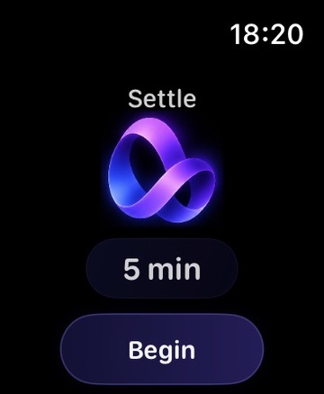
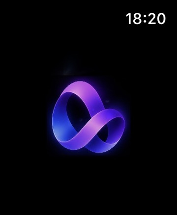
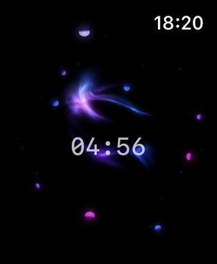

[← Apple developer profile](https://github.com/Charles-drZ)

# GlassBox — iOS & watchOS

**An independent wellbeing and productivity product for iPhone, with Settle as a dedicated Apple Watch meditation experience.**

**Swift · SwiftUI · SwiftData · CloudKit · HealthKit · StoreKit 2 · watchOS**

GlassBox combines habits, tasks, mood, journaling and gentle progression around one product idea: *productivity without guilt*. I work on its SwiftUI implementation, Apple-platform integrations, persistence, debugging, validation and release preparation.

**Status:** Active iPhone TestFlight/product hardening and watchOS refinement. **Not App Store shipped.** Implementation is private; this repository documents the product, engineering decisions and selected real application screenshots.

## See the product

The images below are real, privacy-reviewed iPhone captures from an earlier accepted product state. They are **not** presented as screenshots of the newest Week/Detail redesign.

<p align="center">
  
  
  
  
</p>

- **Self / Mood:** reflection and personal context.
- **Tasks / Habits:** focused planning with careful completion and schedule semantics.
- **Journal:** notes, gratitude and reflection.
- **Reward:** gentle progress and the Vidra companion layer.

Hungarian is the original product language; English localization is also supported.

### Settle on Apple Watch

Three real, owner-supplied watchOS captures from **November 8, 2026** show the Settle meditation interface. These are application views, not rendered concepts; still images do not by themselves validate the underlying Watch runtime or HealthKit side effects.

<p align="center">
  <a href="assets/visuals/settle-duration-selection.jpg"></a>
  <a href="assets/visuals/settle-session-transition.jpg"></a>
  <a href="assets/visuals/settle-active-countdown.jpg"></a>
</p>

**01 — Choose a duration** · **02 — Settle transition** · **03 — Active meditation**

[Read the watchOS engineering case study →](docs/settle-watchos.md)

## Native Apple engineering

**On iPhone:** SwiftUI state, SwiftData and private CloudKit persistence, HealthKit integration, StoreKit 2 foundations, restoration and app lifecycle. Recent accepted development includes historical wellbeing evidence and a read-first Habits experience with a seven-day overview, safe editing paths and bounded reminders.

**On Apple Watch:** Settle provides standalone meditation sessions with 1–60 minute Digital Crown duration selection, session completion/interruption/recovery behavior and HealthKit Mindful Minutes export. Watch-specific continuity and interactions have been exercised on physical Apple Watch hardware; new visual designs still require their own physical acceptance.

**In validation:** compiler success, isolated host tests, source checks, device observations and Product acceptance remain separate. Some recent Habits changes have extensive host-test and generic-build evidence but **no claimed physical UI acceptance**.

## Engineering case studies

- **[Habits: showing only what the data proves](docs/habits-week-evidence.md)** — real SwiftUI product decision, four historical states, pending writes, rejected alternatives, tests and remaining limits.
- **[Settle on Apple Watch](docs/settle-watchos.md)** — runtime continuity, Crown behavior, interruption and HealthKit boundaries.
- **[Technical overview](docs/technical-overview.md)** — native architecture and Apple integration boundaries.
- **[Testing and validation](docs/testing-and-validation.md)** — what different levels of validation actually establish.
- **[Development lessons](docs/development-lessons.md)** — additional decisions and trade-offs.

The private GlassBox source and its actual tests are not published. The separately authored public Swift demonstration below is **not** an extract of the application's implementation.

## Runnable Swift engineering samples

**[HabitEvidenceCore](samples/HabitEvidenceCore/)** is an independently written, dependency-free Swift Package illustrating how a read-only day status can be projected from incomplete or pending evidence. It contains public sample source and ten Swift Testing cases, **not GlassBox application source or copied production tests**.

```sh
swift test --package-path samples/HabitEvidenceCore
```

This executable example supports discussion of engineering choices; passing its tests does not validate the private production code. See the [sample's limitations](samples/HabitEvidenceCore/README.md) and the [source boundary](docs/privacy-and-source-code.md).

**[CivilDayCore](samples/CivilDayCore/)** is a second, entirely new Swift Package demonstrating captured time zones, Gregorian calendar-day arithmetic, 23/25-hour daylight-saving days, leap dates and year boundaries.

```sh
swift test --package-path samples/CivilDayCore
```

The calendar example is **not** extracted from GlassBox's private day-addressing or persistence code. It tests general Foundation date handling; read its [limitations](samples/CivilDayCore/README.md).

## How I develop

GlassBox is also the practical Apple application behind my [skill-guided Codex workflow](https://github.com/Charles-drZ/glassbox-development-workflow). It combines official and project-specific SwiftUI/Xcode/test-evidence skills with accepted scope, source review, native tooling and human acceptance; the skills do not authorize builds or device access by themselves.

## Current limits and public boundary

GlassBox remains under TestFlight/release hardening. Newer features and UX proposals are not automatically accepted because a PR merged or a host test passed.

The repository does not publish private application source, signing/CloudKit/StoreKit configuration, internal fixtures, prompts, operational identifiers or user data. No App Store release is claimed.

[Product overview](docs/product-overview.md) · [Privacy and source code](docs/privacy-and-source-code.md) · [Changelog](CHANGELOG.md)

## Related Apple work

- [GlassPort — native macOS developer workspace](https://github.com/Charles-drZ/glassport-showcase)
- [Skill-guided Apple development workflow](https://github.com/Charles-drZ/glassbox-development-workflow)
- [Developer profile](https://github.com/Charles-drZ)

For future accepted milestones, follow [@Charles-drZ](https://github.com/Charles-drZ).
