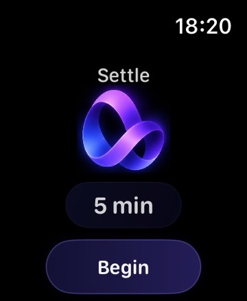
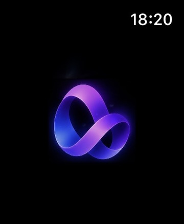
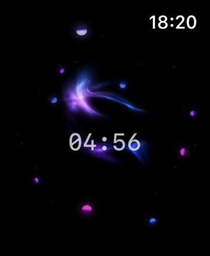

# Settle watchOS engineering

Settle is the meditation surface of the GlassBox product family and a dedicated Apple Watch engineering effort.

The implementation is private. This case study documents the public engineering shape and validated behavior without publishing source, signing configuration, private identifiers, internal tickets, or reusable operational details.

## Product role

The Watch is the primary execution surface for an active meditation session.

The core interaction is intentionally small:

```text
select duration
→ begin
→ run independently on Watch
→ complete / end / recover truthfully
→ export allowed health side effects
→ review broader context on iPhone
```

Settle is designed around short, low-friction sessions rather than turning meditation into another task-management surface.

## Current validated behavior

The current product surface includes:

- integer duration selection from 1 through 60 minutes;
- Digital Crown interaction with native detent feedback;
- a dedicated visual system and meditation renderer;
- explicit begin / active / completion / cancellation / interruption / recovery states;
- wrist-down and display-sleep continuity through `WKExtendedRuntimeSession`;
- completion haptics;
- HealthKit Mindful Minutes export;
- bounded heart-rate collection during the meditation lifecycle;
- no persisted workout artifact for the heart-rate sidecar path;
- dedicated Watch app identity and icon;
- physical Apple Watch product validation for runtime, interaction, motion, and recovery behavior.

## Architecture boundaries

### Domain authority

Session identity, intended duration, timestamps, completion truth, cancellation, and recovery are owned by the meditation domain.

The renderer does not decide whether a session completed.

HealthKit does not decide whether a session completed.

The extended runtime adapter does not decide whether a session completed.

This separation keeps platform callbacks from silently rewriting product truth.

### Extended runtime

Apple Watch may dim or sleep its display while a meditation is still active.

Settle therefore treats scene visibility and session validity as separate concepts. A wrist-down event is not automatically an interruption.

`WKExtendedRuntimeSession` is retained through its lifecycle and invalidation callback so runtime ownership remains explicit instead of depending on incidental object lifetime.

### HealthKit side effects

Mindful Minutes are exported only after the domain has accepted a truthful natural completion.

The heart-rate sidecar is bounded by the same meditation lifecycle but remains separate from session authority. Its purpose is physiological context, not workout creation.

Health permissions and purpose strings are treated as product contracts rather than implementation boilerplate.

## Recovery semantics

Watch apps experience lifecycle events that are easy to hide behind optimistic UI.

Settle instead distinguishes:

- natural completion;
- explicit user end;
- interruption before completion;
- relaunch/recovery;
- resolved interrupted state.

The UI reflects those states rather than retroactively converting an interrupted session into a successful meditation.

## Visual system

The active meditation surface uses a dedicated renderer with product-owned visual semantics.

The renderer receives normalized domain progress and maps it into presentation. It does not own timing truth or session completion.

Motion work is validated on physical Apple Watch hardware because subtle animation that looks obvious in development tooling can become imperceptible or distracting on the actual small OLED display.

Reduce Motion behavior remains a first-class boundary.

### Real Settle watchOS screenshots

These three owner-supplied captures show Settle's **visible** meditation interface on November 8, 2026. They are not generated mockups, and are not independently reproducible without the private application build.

<p align="center">
  <a href="../assets/visuals/settle-duration-selection.jpg"></a>
  <a href="../assets/visuals/settle-session-transition.jpg"></a>
  <a href="../assets/visuals/settle-active-countdown.jpg"></a>
</p>

- **Duration selection:** a five-minute selection with an explicit Begin action. The implementation supports 1–60 minutes and Digital Crown interaction; one still image cannot prove the full interaction range.
- **Transition visual:** Settle's purple ribbon identity during a visual transition. A screenshot does not prove animation smoothness or Reduce Motion behavior.
- **Active meditation:** a live-session countdown captured at 04:56. This frame does not establish background continuity, HealthKit write acceptance, or interruption/recovery correctness.

Real-device behavior and side effects require their own tests and product acceptance, as described below.

## Validation strategy

Validation is layered rather than reduced to one green build.

Depending on the change, evidence has included:

- focused domain tests;
- runtime/coordinator tests;
- HealthKit side-effect tests;
- generic watchOS builds;
- signing/entitlement inspection;
- physical Apple Watch functional smokes;
- physical product acceptance for visual and haptic behavior;
- regression checks around interruption and recovery.

Physical-device acceptance remains authoritative where the result depends on real Watch hardware, runtime behavior, Crown feel, haptics, or display characteristics.

## Current boundary

Settle is a working and physically validated watchOS meditation product surface under active hardening.

This public case study does not claim App Store publication.

It also intentionally does not expose:

- implementation source;
- signing or provisioning details;
- private identifiers;
- internal prompts/tickets;
- raw device logs;
- private roadmap items.
